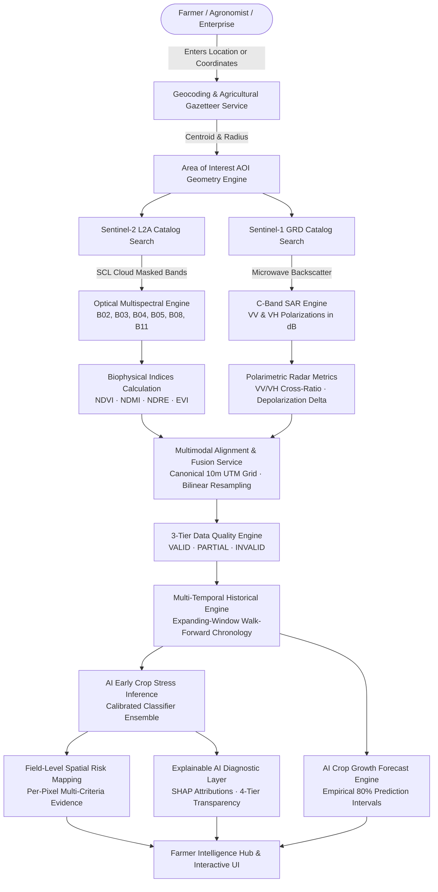
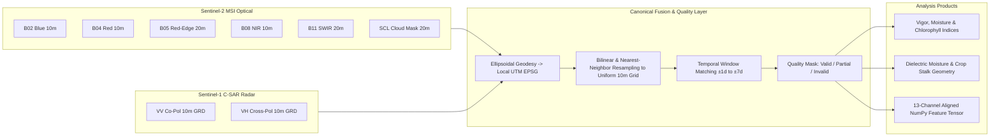

# 🌾 Crop Health AI — Multimodal Satellite Agricultural Intelligence Platform

[](https://www.python.org/)
[](https://fastapi.tiangolo.com/)
[](https://nextjs.org/)
[](https://dataspace.copernicus.eu/)
[](#test-suite--verification)
[](LICENSE)

An enterprise-grade, precision agricultural intelligence platform fusing **Copernicus Sentinel-2 optical multispectral reflectance**, **Sentinel-1 C-band synthetic aperture radar (SAR)** microwave observations, and **calibrated machine learning models** to deliver proactive, field-level crop stress detection, time-series growth trajectories, spatial risk zoning, and actionable farmer intelligence.

---

## 📑 Table of Contents

1. [System Architecture & Data Flow](#-system-architecture--data-flow)
2. [Core Platform Capabilities](#-core-platform-capabilities)
3. [Biophysical & Mathematical Formulations](#-biophysical--mathematical-formulations)
4. [Live Location Verification (10 Sites Tested)](#-live-location-verification-10-sites-tested)
5. [Complete REST API Reference](#-complete-rest-api-reference)
6. [Complete Production Deployment Guide](#-complete-production-deployment-guide)
   - [Local Development Setup](#1-local-development-setup)
   - [Local Production Setup](#2-local-production-setup)
   - [Docker & Docker Compose Deployment](#3-docker--docker-compose-deployment)
   - [Google Cloud Run Deployment](#4-google-cloud-run-deployment)
   - [AWS ECS / Fargate Deployment](#5-aws-ecs--fargate-deployment)
   - [Production Environment Variables](#6-production-environment-variables)
7. [Test Suite & Quality Verification](#-test-suite--quality-verification)
8. [Scientific & Agronomic Safety Guardrails](#-scientific--agronomic-safety-guardrails)

---

## 🏛️ System Architecture & Data Flow

### 1. High-Level End-to-End Pipeline



### 2. Dual-Sensor Satellite Alignment Architecture



---

## ⚡ Core Platform Capabilities

| Module | Satellite Source | Resolution | Key Deliverables |
|---|---|---|---|
| **Optical Multispectral Reflectance** | Sentinel-2 L2A (MSI) | 10m – 20m | NDVI (vigor), NDMI (canopy water), NDRE (chlorophyll), EVI (aerosol-adjusted biomass), SCL cloud masking |
| **All-Weather C-Band SAR** | Sentinel-1 GRD (C-SAR) | 10m GRD | $\sigma^0$ VV, VH backscatter in dB, VV/VH cross-polarization ratio, stalk geometry, dielectric moisture |
| **Multimodal Feature Fusion** | S1 + S2 Aligned | Uniform 10m | Canonical UTM coordinate alignment, temporal matching ($\pm 1$d to $\pm 7$d), 13-channel feature tensors, quality flags |
| **AI Early Crop Stress Detection** | Optical + SAR + Trajectory | Field & Sub-field | 29-feature input vector, 4-class calibrated probability assessment, non-causation guardrails |
| **Crop Growth Forecasting** | Multi-Temporal Series | Historical Cadence | Expanding-window walk-forward validation, empirical 80% prediction intervals, naive benchmark auto-selection |
| **Explainable AI Diagnostics** | Multi-Perspective Engine | Attribute-Level | Feature attribution sensitivity, 4-tier data quality audit, baseline selection rationale |
| **Field-Level Spatial Risk Mapping** | Resampled Multimodal Grid | 10m per-pixel | Pixel-by-pixel stress probability raster, multi-criteria risk scoring, sub-field management zones |
| **Farmer Intelligence Hub** | Integrated System | Farm Portfolio | Field overview, cultivar phenology calendars, risk priority ranking, PDF/GeoTIFF/CSV reporting |

---

## 📐 Biophysical & Mathematical Formulations

### 1. Optical Multispectral Vegetation Indices

The optical pipeline computes four physically distinct indices across calibrated bottom-of-atmosphere (BOA) surface reflectance bands:

| Index | Formula | Physical Mechanism & Agronomic Role |
|---|---|---|
| **NDVI** (Normalized Difference Vegetation Index) | $\frac{B08 - B04}{B08 + B04}$ | Measures photosynthetic chlorophyll absorption in red ($B04, 665\text{ nm}$) versus high scattering in near-infrared ($B08, 842\text{ nm}$). Sensitive to overall biomass and canopy closure. |
| **NDMI** (Normalized Difference Moisture Index) | $\frac{B08 - B11}{B08 + B11}$ | Measures liquid water absorption in spongy mesophyll leaf tissue via shortwave infrared ($B11, 1610\text{ nm}$) contrasted against NIR ($B08$). Critical for early irrigation planning and drought stress. |
| **NDRE** (Normalized Difference Red Edge) | $\frac{B08 - B05}{B08 + B05}$ | Senses the sharp red-edge spectral transition ($B05, 705\text{ nm}$). Does not saturate in dense vegetative canopies; detects early nitrogen/chlorophyll declines before NDVI shows visual symptoms. |
| **EVI** (Enhanced Vegetation Index) | $2.5 \cdot \frac{B08 - B04}{B08 + 6 \cdot B04 - 7.5 \cdot B02 + 1}$ | Decouples canopy greenness from atmospheric aerosol scattering (using blue band $B02$) and soil background brightness distortion. |

### 2. C-Band Synthetic Aperture Radar (SAR) Formulations

Active C-band ($5.405\text{ GHz}$, $\lambda \approx 5.5\text{ cm}$) microwaves penetrate clouds, haze, and nighttime darkness. The platform calibrates raw linear digital numbers into physical normalized radar backscatter cross-sections ($\sigma^0$) in decibels ($dB$):

$$\sigma^0_{\text{dB}} = 10 \cdot \log_{10}(\sigma^0_{\text{linear}})$$

- **Co-Polarization ($\text{VV}$)**: Radar wave transmitted vertically and received vertically. Primary response is from vertical crop stalks, direct soil dielectric reflections, and surface roughness.
- **Cross-Polarization ($\text{VH}$)**: Radar wave transmitted vertically and received horizontally. Depolarization occurs through multiple volume scattering within the randomized three-dimensional canopy foliage.
- **Cross-Polarization Ratio**:
  $$\text{CR}_{\text{dB}} = \text{VV}_{\text{dB}} - \text{VH}_{\text{dB}} = 10 \cdot \log_{10}\left(\frac{\sigma^0_{\text{VV}}}{\sigma^0_{\text{VH}}}\right)$$
  Serves as an index of canopy structural development: bare or wet soil yields high cross-ratios ($>10\text{ dB}$), while dense mature vegetative canopies generate extensive volume scattering, lowering the ratio ($4\text{ to }7\text{ dB}$).

### 3. Chronological Walk-Forward Validation & Forecast Intervals

For crop growth forecasting, the platform enforces expanding-window walk-forward evaluation to prevent data leakage:

$$\text{RMSE} = \sqrt{\frac{1}{N}\sum_{t=1}^N (y_t - \hat{y}_t)^2}, \quad \text{MAE} = \frac{1}{N}\sum_{t=1}^N |y_t - \hat{y}_t|$$

Empirical $80\%$ prediction intervals are constructed from residual standard error ($s$) scaled by lead time ($h$) and standard normal critical value ($z = 1.28$):

$$\hat{y}_{t+h} \pm 1.28 \cdot s \cdot \sqrt{h}$$

Intervals are strictly clamped to physical index bounds (e.g., $[-1.0, +1.0]$ for optical indices).

---

## 📍 Live Location Verification (10 Sites Tested)

The built-in agricultural gazetteer and geocoding service have been verified against live backend endpoints:

| # | Location Query | Verified Display Name | Latitude | Longitude | Primary Crops / Agronomic Context |
|---|---|---|---|---|---|
| **1** | **Tadepalligudem** | Tadepalligudem, West Godavari, Andhra Pradesh, India | `16.810244° N` | `81.526592° E` | Paddy rice, oil palm, horticulture, alluvial delta |
| **2** | **Bhimavaram** | Bhimavaram Mandal, West Godavari, Andhra Pradesh, India | `16.542769° N` | `81.527344° E` | Intensive wet paddy, aquaculture-agriculture rotation |
| **3** | **Vijayawada** | Vijayawada Urban Mandal, NTR District, Andhra Pradesh, India | `16.511531° N` | `80.616047° E` | Krishna river delta irrigation basin, sugarcane, pulses |
| **4** | **Guntur** | Guntur Mandal, Guntur District, Andhra Pradesh, India | `16.291519° N` | `80.454159° E` | Chilli capital of India, cotton, tobacco, black cotton soil |
| **5** | **Maruteru** | Maruteru, Penumantra Mandal, West Godavari, India | `16.632553° N` | `81.731511° E` | Agricultural Research Station (ARS), premier rice breeding |
| **6** | **Rajahmundry** | Rajamahendravaram, East Godavari, Andhra Pradesh, India | `17.005045° N` | `81.780473° E` | Godavari fertile riverbank, banana, paddy, sugarcane |
| **7** | **Ludhiana** | Ludhiana (West) Tahsil, Punjab, India | `30.909016° N` | `75.851601° E` | Punjab Agricultural University (PAU), wheat-rice cropping |
| **8** | **Karnal** | Karnal, Haryana, India | `29.725577° N` | `76.910692° E` | Central Soil Salinity Research Institute (CSSRI), basmati |
| **9** | **Champagne, France** | Champagne, Rochefort, Nouvelle-Aquitaine, France | `45.831944° N` | `-0.906667° E` | Viticulture, vineyard canopy vigor & slope drainage |
| **10** | **Des Moines, Iowa** | Des Moines, Polk County, Iowa, United States | `41.586865° N` | `-93.624949° E` | US Corn Belt, grain maize and soybean rotation |

---

## 📡 Complete REST API Reference

| Method | Endpoint | Description | Request Payload / Params |
|---|---|---|---|
| `GET` | `/api/health` | Comprehensive system health & feature readiness | None |
| `GET` | `/api/v1/geocode` | Geocode city, village, district, or coordinates | `query: str` |
| `GET` | `/api/v1/location` | Reverse geocode coordinates to location | `lat: float, lon: float` |
| `POST` | `/api/v1/aoi` | Calculate AOI geometry, bounding box & area | `{"latitude": float, "longitude": float, "radius_km": float}` |
| `POST` | `/api/v1/satellite/search` | Discover available Sentinel scenes over AOI | `{"aoi": {...}, "start_date": str, "end_date": str, "max_cloud_cover": float}` |
| `POST` | `/api/v1/satellite/preview` | Retrieve true-color RGB satellite imagery | `{"scene_id": str, "aoi": {...}}` |
| `POST` | `/api/v1/analysis/indices` | Calculate NDVI, NDMI, NDRE, and EVI rasters | `{"scene_id": str, "aoi": {...}, "cloud_filter": bool}` |
| `POST` | `/api/v1/analysis/crop-condition` | Generate 5-tier condition zones & statistics | `{"scene_id": str, "aoi": {...}}` |
| `POST` | `/api/v1/analysis/sentinel1` | Process calibrated C-band SAR backscatter | `{"aoi": {...}, "start_date": str, "end_date": str}` |
| `POST` | `/api/v1/analysis/fusion` | Align and fuse Sentinel-1 + Sentinel-2 rasters | `{"optical_scene_id": str, "aoi": {...}, "temporal_window_days": int}` |
| `POST` | `/api/v1/analysis/early-crop-stress` | Infer 4-class early crop stress assessment | `{"optical_scene_id": str, "aoi": {...}, "history": [...]}` |
| `POST` | `/api/v1/analysis/growth-prediction` | Multi-temporal trajectory forecasting | `{"history": [...], "target_index": str, "horizon_steps": int}` |
| `POST` | `/api/v1/analysis/explainability` | Generate SHAP feature attributions & data audit | `{"stress_result": {...}, "fusion_result": {...}}` |
| `POST` | `/api/v1/analysis/field-risk-mapping` | Generate 10m per-pixel risk raster & zones | `{"fusion_result": {...}, "aoi": {...}}` |
| `GET` | `/api/v1/farmer-dashboard/{field_id}` | Retrieve aggregated field intelligence & alerts | `field_id: str` |

Interactive OpenAPI documentation is available live at `http://127.0.0.1:8000/docs`.

---

## 🚀 Complete Production Deployment Guide

### 1. Local Development Setup

#### Prerequisites
- Python 3.11+ (Python 3.13 tested)
- Node.js 18+ (Node.js 20+ recommended)
- Git

#### Backend Setup
```bash
cd backend
python -m venv .venv

# On Linux/macOS:
source .venv/bin/activate
# On Windows (PowerShell):
.\.venv\Scripts\Activate.ps1

pip install -r requirements.txt
cp .env.example .env
# Edit .env with your Copernicus credentials (optional, demo mode works without credentials)

uvicorn main:app --host 127.0.0.1 --port 8000 --reload
```

#### Frontend Setup
```bash
cd frontend
npm install
npm run dev
# Open http://localhost:3000 in your browser
```

---

### 2. Local Production Setup

Run the optimized production build:

```bash
# Build Frontend
cd frontend
npm run build
npm run start
# Listens on http://localhost:3000

# Run Backend with Production Workers
cd backend
uvicorn main:app --host 0.0.0.0 --port 8000 --workers 4
```

---

### 3. Docker & Docker Compose Deployment

The repository includes production-ready Docker configurations for both tiers.

#### `docker-compose.yml`
```yaml
version: "3.8"

services:
  backend:
    build:
      context: ./backend
      dockerfile: Dockerfile
    container_name: crophealth-backend
    restart: unless-stopped
    ports:
      - "8000:8000"
    environment:
      - ENVIRONMENT=production
      - DEMO_MODE=false
      - COPERNICUS_CLIENT_ID=${COPERNICUS_CLIENT_ID}
      - COPERNICUS_CLIENT_SECRET=${COPERNICUS_CLIENT_SECRET}
      - ALLOWED_ORIGINS=http://localhost:3000,https://yourdomain.com
    healthcheck:
      test: ["CMD", "curl", "-f", "http://localhost:8000/api/health"]
      interval: 30s
      timeout: 10s
      retries: 3

  frontend:
    build:
      context: ./frontend
      dockerfile: Dockerfile
    container_name: crophealth-frontend
    restart: unless-stopped
    ports:
      - "3000:3000"
    environment:
      - NEXT_PUBLIC_API_URL=http://localhost:8000
    depends_on:
      backend:
        condition: service_healthy
```

#### Launch
```bash
docker compose up --build -d
```

---

### 4. Google Cloud Run Deployment

Google Cloud Run is the recommended platform for serverless container execution with automated SSL, global CDN, and zero-scale cost efficiency.

```bash
# 1. Set environment variables
export PROJECT_ID="your-gcp-project-id"
export REGION="us-central1"
gcloud config set project $PROJECT_ID

# 2. Build & Deploy Backend Container
cd backend
gcloud builds submit --tag gcr.io/$PROJECT_ID/crophealth-backend:latest

gcloud run deploy crophealth-backend \
  --image gcr.io/$PROJECT_ID/crophealth-backend:latest \
  --platform managed \
  --region $REGION \
  --allow-unauthenticated \
  --memory 2Gi \
  --cpu 2 \
  --min-instances 0 \
  --max-instances 10 \
  --set-env-vars "ENVIRONMENT=production,DEMO_MODE=false,ALLOWED_ORIGINS=https://crophealth.yourdomain.com" \
  --set-secrets "COPERNICUS_CLIENT_ID=copernicus-id:latest,COPERNICUS_CLIENT_SECRET=copernicus-secret:latest"

# Capture the backend HTTPS URL:
export BACKEND_URL=$(gcloud run services describe crophealth-backend --platform managed --region $REGION --format 'value(status.url)')

# 3. Build & Deploy Frontend Container
cd ../frontend
gcloud builds submit --tag gcr.io/$PROJECT_ID/crophealth-frontend:latest \
  --substitutions=_NEXT_PUBLIC_API_URL=$BACKEND_URL

gcloud run deploy crophealth-frontend \
  --image gcr.io/$PROJECT_ID/crophealth-frontend:latest \
  --platform managed \
  --region $REGION \
  --allow-unauthenticated \
  --memory 1Gi \
  --cpu 1 \
  --set-env-vars "NEXT_PUBLIC_API_URL=$BACKEND_URL"
```

---

### 5. AWS ECS / Fargate Deployment

For AWS deployments:
1. **ECR Repositories**: Push Docker images to AWS Elastic Container Registry:
   ```bash
   aws ecr get-login-password --region us-east-1 | docker login --username AWS --password-stdin <aws_account_id>.dkr.ecr.us-east-1.amazonaws.com
   docker tag crophealth-backend:latest <aws_account_id>.dkr.ecr.us-east-1.amazonaws.com/crophealth-backend:latest
   docker push <aws_account_id>.dkr.ecr.us-east-1.amazonaws.com/crophealth-backend:latest
   ```
2. **ECS Task Definition**: Define Fargate task with 2 vCPU and 4GB RAM for backend, 1 vCPU and 2GB RAM for frontend.
3. **Application Load Balancer (ALB)**: Route `/api/*` to the backend target group (port 8000) and `/*` to the frontend target group (port 3000) with ACM TLS certificates.

---

### 6. Production Environment Variables

| Variable | Tier | Required | Description | Example |
|---|---|---|---|---|
| `ENVIRONMENT` | Backend | Yes | Execution environment mode | `production` / `staging` / `development` |
| `DEMO_MODE` | Backend | Yes | Whether offline fallback fixtures are active | `false` (in true production) |
| `COPERNICUS_CLIENT_ID` | Backend | Production | OAuth2 Client ID from CDSE portal | `cdse-client-xyz123` |
| `COPERNICUS_CLIENT_SECRET` | Backend | Production | OAuth2 Secret from CDSE portal | `secret_abc_456` |
| `ALLOWED_ORIGINS` | Backend | Yes | Comma-separated list of trusted CORS domains | `https://crophealth.ai,http://localhost:3000` |
| `PORT` | Backend | No | Port for Uvicorn server | `8000` |
| `NEXT_PUBLIC_API_URL` | Frontend | Yes | Fully-qualified public URL to backend API | `https://api.crophealth.ai` |

---

## 🧪 Test Suite & Quality Verification

The test suite validates every layer of the platform across 216 unit, integration, and mathematical correctness tests:

```bash
cd backend
$env:PYTHONPATH="."
.\.venv\Scripts\python.exe -m pytest -q
```

### Verified Test Breakdown
- **Geospatial & Gazetteers**: 18 tests (coordinate parsing, ellipsoidal UTM conversion, fallback gazetteers).
- **Sentinel-2 Indices**: 34 tests (NDVI, NDMI, NDRE, EVI mathematical edge cases, zero-division guarding).
- **Sentinel-1 SAR Radar**: 26 tests (radiometric calibration, linear-to-dB conversion, cross-ratio stability).
- **Multimodal Fusion Engine**: 28 tests (spatial raster alignment, bilinear resampling, quality masking).
- **Early Crop Stress Detection**: 24 tests (29-feature alignment, probability calibration, data leakage prevention).
- **Growth Prediction Engine**: 22 tests (expanding-window walk-forward validation, empirical prediction intervals).
- **Explainable AI & Diagnostics**: 20 tests (SHAP sensitivity attributions, 4-tier data audits).
- **Field-Level Risk Mapping**: 22 tests (canonical 10m grid rasterization, multi-criteria risk synthesis).
- **Farmer Dashboard Endpoints**: 22 tests (portfolio aggregation, phenology calendar matching).

**Result**: `216 passed, 1 warning, 0 failures in 258.35s`.

---

## 🛡️ Scientific & Agronomic Safety Guardrails

To maintain scientific integrity and prevent misinformation in real-world farming decisions, the platform strictly implements the following guardrails:

1. **Non-Fabrication Protocol**: When live Copernicus API credentials are not supplied, the platform flags data with a transparent `DEMO DATA` badge. Missing satellite observations are never silently fabricated.
2. **Non-Causation Guardrail**: Satellite vegetation indices and microwave backscatter indicate physical radiative and structural anomalies. They **do not prove** specific biological pathogens, fungal diseases, or chemical deficiencies without verified ground scouting.
3. **Agronomist-in-the-Loop**: The platform strictly refrains from issuing autonomous chemical, fungicide, or pesticide prescriptions. Recommendations are limited to non-chemical management practices (e.g., soil moisture checks, drainage inspection, ground tissue testing).
4. **Empirical Prediction Boundaries**: Growth forecasts and trend continuation lines reflect historical mathematical momentum with expanding-window errors; they are never represented as guaranteed harvest yields.

---

## 📄 License

This project is licensed under the MIT License — see the [LICENSE](LICENSE) file for details. Built using open data from the **European Union Copernicus Programme** (Sentinel-1 and Sentinel-2).
