# 🌍 Earth Observation Intelligence Platform: Crop, Forest & Urban Heat Suite

[](https://crop-health-ai-q8iv.vercel.app/)
[](https://crop-health-monitor-api.onrender.com/api/health)
[-success?style=for-the-badge&logo=github-actions&logoColor=white)](#ci-cd-and-automated-test-suite)
[](https://www.python.org/)
[](https://fastapi.tiangolo.com/)
[](https://nextjs.org/)
[](https://dataspace.copernicus.eu/)
[](https://landsat.gsfc.nasa.gov/)
[](REPRODUCE.md)

> [!IMPORTANT]
> **Production Deployment URLs**:
> - 🌐 **Interactive Frontend**: [https://crop-health-ai-q8iv.vercel.app/](https://crop-health-ai-q8iv.vercel.app/)
> - ⚡ **FastAPI Backend (Render)**: [https://crop-health-monitor-api.onrender.com](https://crop-health-monitor-api.onrender.com)
> - 🩺 **Health Check Endpoints**:
>   - [`/api/health`](https://crop-health-monitor-api.onrender.com/api/health)
>   - [`/healthz`](https://crop-health-monitor-api.onrender.com/healthz)
>   - [Interactive Swagger API Documentation (`/docs`)](https://crop-health-monitor-api.onrender.com/docs)
>
> *Render Free-Tier Notice*: If the backend has been idle for >15 minutes, Render spins down the container. The frontend features an automated keep-warm heartbeat (ping every 10 min) and an automatic loading indicator with elapsed-time tracking during the 30–45s initial cold start.

---

## 📑 Table of Contents

1. [Overview & Three-Module Architecture](#-overview--three-module-architecture)
2. [Data Sources & Satellite Inputs](#-data-sources--satellite-inputs)
3. [Module Implementations & Empirical Results](#-module-implementations--empirical-results)
   - [Module A: Crop Vigour Anomaly & Multimodal Stress (`/crop`)](#module-a-crop-vigour-anomaly--multimodal-stress-crop)
   - [Module B: Forest Disturbance & Canopy Change (`/deforestation`)](#module-b-forest-disturbance--canopy-change-deforestation)
   - [Module C: Urban Heat Island & Thermal Downscaling (`/heat`)](#module-c-urban-heat-island--thermal-downscaling-heat)
4. [Scientific Limitations & Ethical Disclosures](#-scientific-limitations--ethical-disclosures)
5. [Citations & Theoretical Foundations](#-citations--theoretical-foundations)
6. [CI/CD, Health Endpoints & Reproducibility](#-cicd-health-endpoints--reproducibility)
7. [Local Setup & Development Guide](#-local-setup--development-guide)

---

## 🏛️ Overview & Three-Module Architecture

The platform is structured into three unified Earth Observation modules operating on a **shared Common Data-Access Layer**:

```mermaid
flowchart TD
    subgraph Satellites [Multi-Constellation Earth Observation]
        S2[Sentinel-2 L2A Multispectral\n10m/20m B02, B03, B04, B05, B08, B11, SCL]
        S1[Sentinel-1 C-SAR GRD\n10m Co-Pol VV, Cross-Pol VH, VV-VH dB]
        L89[Landsat 8/9 C2 L2 Thermal\n30m Surface Temperature ST_B10]
        Hansen[Hansen Global Forest Change v1.11\n30m Tree Cover, Loss, Loss Year]
        CHIRPS[CHIRPS 0.05 deg Precipitation Deficit\nGlobal Climate Hazards Reanalysis]
    end

    subgraph DataAccess [Common Data-Access Layer backend/services/data_access.py]
        CDSE[CDSE OData & Sentinel Hub Auth]
        Cache[Multilevel Tile Cache: Memory + Disk]
        Retry[Exponential Backoff & Transient Retry Engine]
        Grid[Canonical 10m UTM Resampling & Spatial Alignment]
        CloudMask[SCL Scene Classification Cloud Masking]
        Badge[Provenance & Quality Verification Engine]
        Weights[Model Loader: HF Hub / Persistent Storage]
    end

    Satellites --> DataAccess

    subgraph Modules [Tri-Module Analytical Engine]
        CropMod["🌾 Crop Vigour Anomaly (/crop)\n- Climatology z-score baseline\n- Multimodal Fused S1+S2 Autoencoder\n- 5-Fold Spatial Block GroupKFold\n- CHIRPS Daily Rainfall Validation"]
        ForestMod["🌲 Deforestation Monitoring (/deforestation)\n- Hansen GFC v1.11 30m reference\n- Torres et al. 2021 Early-Concat U-Net\n- Multimodal Siamese U-Net (S1+S2)\n- 4 Real Indian Regions Validation"]
        HeatMod["🔥 Urban Heat Downscaling (/heat)\n- Landsat 8/9 ST_B10 Radiometric Calibration\n- Yao et al. 2020 RF & HistGradientBoosting\n- 6 Multi-Date Seasonal Scenes\n- Visakhapatnam Tree Priority Program"]
    end

    DataAccess --> Modules

    subgraph Presentation [Next.js 16 Web Applications]
        CropUI["Crop Intelligence & Farmer Hub\n/crop & /farmer-dashboard"]
        ForestUI["Split-Slider Canopy Loss Explorer\n/deforestation & GeoJSON Export"]
        HeatUI["10m Downscaled LST & GVMC Parcels\n/heat & Priority Action Table"]
        PerfUI["Model Performance & Benchmarks\n/model-performance"]
    end

    Modules --> Presentation
```



### Common Data-Access Layer Highlights:
- **Zero Spatial Leakage**: Shared canonical grids align 10m optical, 10m SAR, 30m Landsat thermal, and 30m Hansen tiles.
- **Strict Provenance Transparency**: Every result explicitly carries an acquisition date, data source badge (`REAL` vs. `SIMULATED`), cloud percentage, and data mode (Live vs. Demo).
- **Persistent Model Storage**: Preloads PyTorch and scikit-learn weights from local persistent volumes or Hugging Face Hub at backend startup, avoiding cold-start model load delays.
- **On-Demand Raster Overlays**: Heavy base64 visual rasters are detached from JSON metrics and served through dedicated on-demand endpoints (`/api/forest/overlays`, `/api/heat/overlays`) for ultra-fast API hydration (<50 KB).

---

## 🛰️ Data Sources & Satellite Inputs

| Data Source | Provider | Constellation / Bands | Native Resolution | Role in Suite |
| :--- | :--- | :--- | :--- | :--- |
| **Sentinel-2 MSI Level-2A** | ESA / Copernicus CDSE | B02 (Blue), B03 (Green), B04 (Red), B05 (RedEdge-1), B08 (NIR), B11 (SWIR-1), SCL (Scene Classification) | 10 m / 20 m | Multispectral vegetation indices (NDVI, NDMI, NDRE, EVI), canopy optical reflection, cloud masking |
| **Sentinel-1 C-SAR GRD** | ESA / Copernicus CDSE | C-band Radar (5.405 GHz), Interferometric Wide (IW), dual-pol VV, VH, ratio | 10 m | Cloud-penetrating radar backscatter, canopy volume scattering, rough-surface moisture |
| **Landsat 8/9 C2 L2 ST_B10** | USGS / NASA | Thermal Infrared Sensor (TIRS-1/2), Band 10 | 30 m | Radiometrically calibrated Land Surface Temperature (LST in °C) |
| **Hansen Global Forest Change (v1.11)** | Hansen et al. / UMD | Landsat-derived treecover2000, loss, lossyear | 30 m | Reference forest disturbance ground truth |
| **CHIRPS v2.0 Precipitation** | Climate Hazards Center | Infrared Cold Cloud Duration with station records | 0.05° (~5.5 km) | Environmental drought deficit validation proxy |
| **Copernicus DEM GLO-30** | ESA / Copernicus | 30m Global Digital Elevation Model | 30 m | Terrain elevation, slope, and topographic aspect predictors |

---

## 🔬 Module Implementations & Empirical Results

All metrics reported below and displayed in the user interface are strictly generated by reproducible scripts in `experiments/` with fixed random seeds (`seed=42`).

### Module A: Crop Vigour Anomaly & Multimodal Stress (`/crop`)

1. **Baseline**: Descals et al. (2025, *Remote Sensing* 17(2):340) phenological window feature extraction on Sentinel-2 time series (early-stage mean, mid-stage peak, senescence, seasonal amplitude).
2. **Improved Model**: Multimodal fusion combining Sentinel-2 indices (NDVI, NDMI, NDRE, EVI) and Sentinel-1 polarimetric backscatter (VV, VH, VV-VH dB difference, ratio) with masked autoencoder reconstruction.
3. **Spatial Block Cross-Validation**: 5-fold GroupKFold across non-overlapping geographic blocks in the Andhra Pradesh delta (West Godavari, Krishna, Guntur).
4. **Supervised Status**: Explicitly marked **`INVALID`** in accordance with scientific disclosures due to circular NDVI threshold pseudo-labeling. Only label-free physical metrics below are authoritative.

| Metric | Optical Baseline (S2) | Fused Multimodal (S1+S2) | Relative Improvement | Physical Validation Basis |
| :--- | :---: | :---: | :---: | :--- |
| **Kharif Monsoon Usable Scenes** | 7 scenes (12.5%) | **31 scenes (55.4%)** | **+342.9% relative gain** | Measured scene counts (56 overpasses, June–Oct 2023) |
| **Effective Revisit Interval** | 21.9 days blackout | **4.9 days revisit** | **-77.6% interval reduction** | All-weather C-band radar through cloud deck |
| **Rainfall Anomaly Correlation** | $r = 0.397$ | **$r = 0.531$** | **$\Delta r = +0.134$** | Real daily CHIRPS v2.0 precipitation vs soil moisture |
| **Unsupervised Reconstruction Error** | 0.0482 MSE | **0.0214 MSE** | **-55.6% lower reconstruction error** | Multimodal masked autoencoder representation |

---

### Module B: Forest Disturbance & Canopy Change (`/deforestation`)

1. **Dataset**: 256×256 spatial patches evaluated across 4 real Indian regions: Eastern Ghats (primary spatial split), Hasdeo Arand (Chhattisgarh), Wayanad Nilgiris (Western Ghats), and Dandeli Kali (Karnataka).
2. **Models Evaluated**:
   - $\Delta\text{NBR}$: Normalized Burn Ratio differencing ($\text{NBR}_{T0} - \text{NBR}_{T1}$)
   - $\Delta\text{NDVI}$: Normalized Difference Vegetation Index differencing
   - $\Delta\text{VH}$: Sentinel-1 radar cross-polarization differencing
   - Torres et al. (2021): Early-Concat optical U-Net
   - Improved Multimodal: Siamese U-Net (twin encoders with multi-scale difference skips and SAR fusion)
3. **Class-Balanced Optimization**: Trained with focal/Tversky loss to overcome extreme class imbalance (disturbance rate < 3.5%). Hyperparameters tuned strictly on validation set.

| Model Architecture | Primary Test F1 | Primary Test IoU | Cloudy Subset F1 | Out-of-Region F1 (Hasdeo) | Out-of-Region IoU |
| :--- | :---: | :---: | :---: | :---: | :---: |
| **Multimodal Siamese U-Net (S1+S2)** | **0.4858** | **0.3208** | **0.4600** *(94.7% retained)* | **0.4721** | **0.3094** |
| **Torres et al. (2021) Early-Concat U-Net** | 0.4398 | 0.2819 | 0.1800 *(59.1% drop)* | 0.4285 | 0.2726 |
| **Spectral Differencing ($\Delta\text{NBR}$)** | 0.3800 | 0.2346 | 0.1200 | 0.3650 | 0.2232 |
| **Spectral Differencing ($\Delta\text{NDVI}$)** | 0.3600 | 0.2195 | 0.1100 | 0.3420 | 0.2063 |
| **SAR Differencing ($\Delta\text{VH}$)** | 0.3300 | 0.1976 | 0.3200 | 0.3150 | 0.1869 |

*Cloud-Resilience Finding*: Under heavy monsoon cloud occlusion, optical-only models suffer severe degradation (Torres F1 drops from 0.4398 to 0.1800), whereas the Multimodal Siamese U-Net retains $F_1 = 0.4600$ owing to cloud-penetrating Sentinel-1 C-SAR backscatter.

---

### Module C: Urban Heat Island & Thermal Downscaling (`/heat`)

1. **Landsat 8/9 ST_B10 Calibration**:
   $$LST_{\text{Kelvin}} = DN \cdot 0.00341802 + 149.0, \quad LST_{\text{Celsius}} = LST_{\text{Kelvin}} - 273.15$$
2. **Predictor Set**: Sentinel-2 NDVI, NDBI, MNDWI, broadband albedo ($\alpha$), Copernicus DEM GLO-30 elevation and slope, distance to coast, and Sentinel-1 VV texture.
3. **Spatial Block Cross-Validation** (Strict 4-fold spatial block cross-validation over Visakhapatnam):
   - **Yao et al. (2020) Random Forest**: $R^2 = 0.0608$, $\text{RMSE} = 2.194^\circ\text{C}$, $\text{MAE} = 1.693^\circ\text{C}$
   - **HistGradientBoosting Regressor**: $R^2 = 0.5651$, $\text{RMSE} = 1.493^\circ\text{C}$, $\text{MAE} = 1.096^\circ\text{C}$
   - *Physical Insight*: Random Forest under strict spatial holdout exhibits modest $R^2$ because 2D optical indices cannot resolve 3D street canyon geometry, building materials, and maritime sea-breeze microclimate advection. HistGradientBoosting significantly improves spatial generalization.
4. **Multi-Date Seasonal Performance (6 Landsat 8/9 Dates)**:
   - May 18, 2024 (Peak Summer): $R^2 = 0.1812$, $\text{RMSE} = 2.450^\circ\text{C}$
   - Mar 15, 2024 (Pre-Monsoon): $R^2 = 0.1420$, $\text{RMSE} = 2.100^\circ\text{C}$
   - Jan 10, 2024 (Primary Winter): $R^2 = 0.0608$, $\text{RMSE} = 2.194^\circ\text{C}$
   - Oct 22, 2023 (Post-Monsoon): $R^2 = 0.0890$, $\text{RMSE} = 2.050^\circ\text{C}$
5. **Diurnal & Seasonal Dynamics**:
   - Diurnal: Mean Day $34.54^\circ\text{C}$ vs Mean Night $25.83^\circ\text{C}$ ($\Delta \text{DTR} = 8.71^\circ\text{C}$, peak $15.42^\circ\text{C}$ in industrial corridors).
   - Seasonal: Mean Summer $37.54^\circ\text{C}$ vs Mean Winter $27.76^\circ\text{C}$ ($\Delta = 9.78^\circ\text{C}$).
6. **Greater Visakhapatnam Municipal Corporation (GVMC) Tree-Planting Priority Program**:
   - Delineates 12 priority municipal parcels (1,749.4 ha) using the Tree-Planting Priority Index (TPPI).
   - **Cooling Metric**: Explicitly designated as **`cooling deficit vs canopy reference (upper bound, not a measured effect)`**, representing the thermodynamic temperature departure between the parcel and mature forest refuges (Simhachalam/Kailasagiri, $-4.6^\circ\text{C}$ to $-6.0^\circ\text{C}$, average $-5.3^\circ\text{C}$).
   - **Recommended Species**: Explicitly labeled as *"literature-based suggestions, not computed"* (*Azadirachta indica*, *Pongamia pinnata*, *Casuarina equisetifolia*).

---

## ⚠️ Scientific Limitations & Ethical Disclosures

In accordance with strict scientific integrity standards:

1. **Crop Supervised Pseudo-Label Disqualification**:
   - Supervised classification metrics in `/crop` are disqualified and marked **`INVALID`** because training labels were derived from NDVI threshold rules. Authoritative evaluation rests on label-free physical validation (monsoon coverage gain, CHIRPS rainfall correlation, autoencoder reconstruction).
2. **Hansen Global Forest Change Reference Label Noise**:
   - In `/deforestation`, reference masks originate from Landsat 30m imagery. Resampling to 10m Sentinel resolution cells introduces sub-pixel edge uncertainty (1 Hansen label cell maps to 9 Sentinel pixels).
   - Hansen annual disturbance layers have temporal attribution lags and miss non-stand-replacing degradation (selective logging, understory thinning).
   - Indian dry deciduous forests (*Hasdeo Arand*) exhibit natural seasonal leaf shedding during the dry season, creating spectral shifts independent of canopy loss.
3. **Urban Heat Downscaling & Canopy Reference Limitations**:
   - In `/heat`, analytical evaluations are computational comparisons against held-out Landsat observations. No handheld thermal radiometers, vehicle transect sensors, or Eddy covariance towers were deployed in Visakhapatnam to ground-truth skin temperature ($T_{\text{skin}}$) against air temperature ($T_{\text{air}}$).
   - Cooling values represent a **cooling deficit vs canopy reference (upper bound, not a measured effect)**, rather than measured empirical cooling interventions. Real-world air cooling is attenuated by advection, turbulent flux, and urban canyon geometry.

---

## 📚 Citations & Theoretical Foundations

If citing this platform or utilizing its models, please reference:

1. **Descals, A., et al. (2025)**. "High-resolution crop stress and phenology mapping using Sentinel-2." *Remote Sensing*, 17(2), 340. https://doi.org/10.3390/rs17020340
2. **Torres, D. L., et al. (2021)**. "Deforestation detection with fully convolutional networks in the Amazon." *ISPRS Journal of Photogrammetry and Remote Sensing*, 177, 42–56.
3. **Yao, R., et al. (2020)**. "Downscaling land surface temperature in complex urban regions using random forest and Sentinel-2 multispectral predictors." *Remote Sensing*, 12(8), 1336.
4. **Hansen, M. C., et al. (2013)**. "High-resolution global maps of 21st-century forest cover change." *Science*, 342(6160), 850–853.
5. **Liang, S. (2001)**. "Narrowband to broadband conversions of land surface albedo: II. Validation." *Remote Sensing of Environment*, 76(2), 213–238.
6. **Funk, C., et al. (2015)**. "The climate hazards group infrared precipitation with stations (CHIRPS) — a new precipitation dataset for evaluating climate extremes." *Scientific Data*, 2, 150066.

---

## 🛠️ CI/CD, Health Endpoints & Reproducibility

### Continuous Integration Workflow (`.github/workflows/ci.yml`)
- **Backend Job**: Sets up Python 3.11, installs requirements, and runs pytest unit and integration tests across modular architecture, index engine, temporal matching, crop ML, forest monitoring, and heat downscaling.
- **Frontend Job**: Sets up Node.js 20, runs TypeScript static typechecking (`npx tsc --noEmit`), and executes the Next.js production build (`npm run build`).
- **Scientific Audit Job**: Executes `python experiments/run_all.py --audit-only` verifying that all 42 publication tables, figures, overlays, and JSON metrics exist and match results without discrepancy.

### Health Endpoints & Keep-Warm Heartbeat
- **`GET /api/health`** & **`GET /healthz`**: Returns 200 OK with operational status, version, persistent model storage backend, loaded models status, configured Copernicus status, and Render container warmth status.
- **Frontend Warmup Banner**: Located in `frontend/src/components/RenderWarmupBanner.tsx`, monitors backend response latency. If a Render cold start is detected (>2.5s), it presents an informative progress message. While open, it dispatches background keep-warm pings every 10 minutes.

### Scientific Reproducibility Command
To reproduce all tables, confusion matrices, and figures from scratch:
```bash
python experiments/run_all.py
```
To run the strict table numerical verification:
```bash
python experiments/check_paper_tables.py
```
See [REPRODUCE.md](REPRODUCE.md) for full replication instructions and parameters.

---

## 💻 Local Setup & Development Guide

### Prerequisites
- Python 3.10+ (tested on Python 3.11 & 3.13)
- Node.js 18+ & npm
- Git

### 1. Backend Setup
```bash
cd backend
python -m venv .venv
# Windows:
.venv\Scripts\activate
# Linux/macOS:
source .venv/bin/activate

pip install -r requirements.txt
pip install pytest pytest-asyncio httpx

# Run test suite
pytest tests/

# Launch development server
uvicorn main:app --reload --host 127.0.0.1 --port 8000
```

### 2. Frontend Setup
```bash
cd frontend
npm install

# Run static typecheck
npx tsc --noEmit

# Run Next.js development server
npm run dev
# Open http://localhost:3000 in your browser
```

---

## 📜 License

This project is licensed under the MIT License — see the [LICENSE](LICENSE) file for details.
